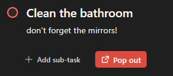
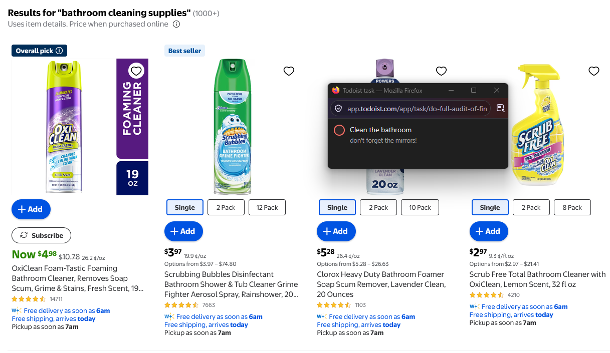

# Pop Out for Todoist

A Firefox extension (151+) that pops a task from Todoist web into a small always-on-top window. Click the circle to complete the task; the row disappears, and the window closes when it's empty.

> Pop Out for Todoist is not created by, affiliated with, or supported by Todoist or Doist.

The **Pop out** button appears next to **Add sub-task** on an open task:



The task then floats in a small window that stays on top of other apps, here a shopping site:



## Install

The extension is not on addons.mozilla.org yet. Until it is, install it from source:

- *Quick test:* go to `about:debugging#/runtime/this-firefox` → **Load Temporary Add-on…** → pick `manifest.json`. It's removed when Firefox restarts.
- *Permanent install:* Firefox only installs signed add-ons. Sign your own copy for free as an unlisted (private) add-on:
  1. Create API credentials at <https://addons.mozilla.org/developers/addon/api/key/>.
  2. Change the `id` in `manifest.json` (under `browser_specific_settings.gecko`) to one of your own, such as `todoist-popout@your-domain.example`. The published ID is reserved for the official listing.
  3. In this folder run:
     ```
     npx web-ext sign --channel=unlisted --api-key=YOUR_KEY --api-secret=YOUR_SECRET
     ```
  4. Open the signed `.xpi` it downloads into `web-ext-artifacts/` in Firefox (drag it onto a window) and accept the install.

## Setup

1. **Get your API token.** Todoist → Settings → Integrations → Developer → copy the API token.
2. **Settings** open on first install (or click the toolbar button). Paste the token, click **Save and test**, and allow site access if Firefox asks.
3. Reload any open Todoist tabs.

## Using it

1. On <https://app.todoist.com>, click a task to open it.
2. Click the red **Pop out** button next to **Add sub-task**, or press **Shift+P** (when you're not typing in a field).
3. Click the circle in the floating window to complete the task.

- Pop out more tasks and they stack in the same window (browsers allow one picture-in-picture window at a time).
- Hover a row and click **×** to remove it from the window without completing it.
- Recurring tasks move to their next date, the same as checking them off in Todoist.

## Things to know

- The pop-out window belongs to the Todoist tab. Reloading or closing that tab closes it.
- It only opens from a click or key press in the Todoist page (a browser rule for picture-in-picture). Firefox doesn't count Alt or Ctrl key combinations, which is why the shortcut is Shift+P.
- Firefox always shows the address bar at the top of the pop-out window as an anti-spoofing measure; extensions can't hide it.
- If the **Add sub-task** button can't be found (for example, Todoist changed its layout or you use another language), the Pop out button floats in the bottom-right corner instead.
- Titles and descriptions wrap and reflow when you resize the window. The window opens sized to the first task, up to 480 px tall.
- Desktop only: Firefox for Android doesn't support Document Picture-in-Picture.

## Privacy

Your API token is stored in your Firefox profile (`browser.storage.local`) and sent only to `api.todoist.com`. The extension contacts Todoist only when you test your token, pop out a task, or complete one. Nothing is sent to the developer, and there is no analytics or tracking. See [PRIVACY.md](PRIVACY.md).

To remove the token, clear the field in settings and click **Save and test**, or uninstall the extension.

## Development

There's no build step; the files in this folder are the extension. [web-ext](https://github.com/mozilla/web-ext) (needs Node.js) helps with testing and packaging:

```
npx web-ext run      # launch a temporary Firefox profile with the extension loaded
npx web-ext lint     # run the addons.mozilla.org linter
npx web-ext build    # package into web-ext-artifacts/ (skips the files listed in web-ext-config.mjs)
```

If Todoist changes its task URL format, update `taskIdFromUrl()` in `content.js`.

| File | What it does |
| --- | --- |
| `manifest.json` | Extension manifest (MV3, Firefox) |
| `background.js` | Holds the token and calls the Todoist API |
| `content.js` / `content.css` | Pop-out button, shortcut, and the always-on-top window |
| `options.html` / `.js` / `.css` | Settings page for the token and site access |
| `icons/icon.svg` | Toolbar and add-on icon |
| `docs/amo-listing.md` | Draft text for the addons.mozilla.org listing |

## License

[MIT](LICENSE) © 2026 Matthew Chandler

Todoist is a trademark of Doist. This project uses the public [Todoist API](https://developer.todoist.com/) and is not endorsed by Doist.
